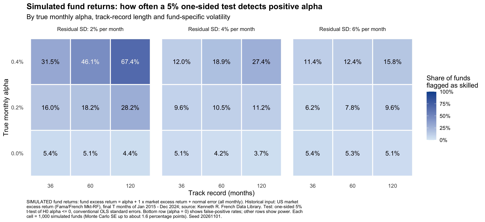
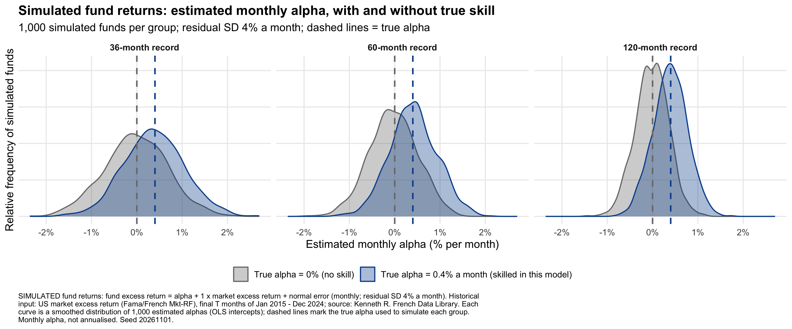

# Skill or Luck? How much evidence do we need to identify a skilled fund manager?

A Monte Carlo study in R. It asks whether a standard alpha regression can tell a genuinely skilled fund manager from a lucky one, and how the answer depends on the size of the edge, the length of the track record and how noisy the fund's returns are.

**In one sentence:** in this simulated setting, a standard one-sided 5% test usually fails to flag a genuinely skilled manager. Even with 10 years of monthly data and a true edge of 0.4% a month (about 4.8% a year), no scenario reached the conventional 80% power.



## The question

A good track record looks reassuring, but luck can produce one. If we *know* which simulated managers are skilled, how often does a standard test agree?

## Design

For each simulated fund:

```
fund excess return = alpha + beta x market excess return + error      (true beta = 1)
```

| Setting | Values |
|---|---|
| True monthly alpha | 0%, 0.2%, 0.4% |
| Track record | 36, 60 or 120 months |
| Monthly residual SD | 2%, 4% or 6% |
| Repetitions | 1,000 funds per scenario (27 scenarios, 27,000 funds) |
| Market input | Kenneth French `Mkt-RF`, Jan 2015 to Dec 2024 (shorter records use the final 36 or 60 months) |
| Test | OLS of fund excess return on market excess return; one-sided 5% t-test of H0: alpha <= 0, with T - 2 degrees of freedom and conventional standard errors |

"Detected" means the test rejected H0 for that fund. Where true alpha is zero, the rejection rate is the false-positive rate.

## Results

Share of funds flagged as skilled when true alpha is 0.4% a month:

| Monthly residual SD | 36 months | 60 months | 120 months |
|---|---|---|---|
| 2% | 31.5% | 46.1% | 67.4% |
| 4% | 12.0% | 18.9% | 27.4% |
| 6% | 11.4% | 12.4% | 15.8% |

- No scenario reached 80% power. For true alpha of 0.2% a month, detection ranged from 6.2% to 28.2%.
- With a Monte Carlo standard error of up to about 1.6 percentage points at 1,000 repetitions, small gaps (for example 11.4% against 12.4%) are within noise.
- With zero true alpha, 3.7% to 5.4% of funds were flagged across the nine scenarios, and 4.99% in a separate rerun with 20,000 funds in each of the nine zero-alpha scenarios (180,000 funds, a different seed).
- Estimates for skilled and unskilled funds overlap heavily. At 36 months and 4% noise, the standard deviation of estimated alpha (about 0.7 percentage points a month) is larger than the 0.4 true edge.



## Validation

- A single simulated fund was checked by hand against `lm()` while building the pipeline.
- Simulated detection rates were compared with exact power from the non-central t distribution in all 27 scenarios (`scripts/5_extra_validation.R`). Differences were within Monte Carlo error.
- The zero-alpha rerun checks that the test's false-positive rate is close to 5%.

The power of a t-test has a closed form, so this project is a demonstration and a check of my own understanding, not a new result. The question itself is well studied in the mutual-fund literature.

## Limitations

- Constant alpha and beta, independent normal errors, one risk factor, no fees, no survivorship or selection effects, and no multiple-testing correction. Several of these would tend to make apparent skill look *better* than it is in real data.
- One market window. Shorter records are the *later* slices of the same decade (36 months starts Jan 2022; 60 months starts Jan 2020), so record length is mixed with which market months are included.
- Residual SDs of 2%, 4% and 6% a month are about 7%, 14% and 21% a year. The higher levels are high-noise cases, so read the numbers as illustrative, not as estimates for real managers.
- "Skill" here means positive alpha by assumption. In real data a positive alpha can reflect risks the model has missed.

## How to run

You need R (developed on R 4.5.2) and the packages `ggplot2` and `dplyr`.

1. Clone or download this repository and open the `.Rproj` file in RStudio.
2. Install the packages once, in the Console: `install.packages(c("ggplot2", "dplyr"))`
3. Session > Restart R, then in the Console run: `source("run_all.R")`

The full run needs an internet connection (it downloads the market data). The master simulation seed is `20261101`; the zero-alpha rerun uses `20261102`.

## Repository structure

| File | What it does |
|---|---|
| `run_all.R` | Runs the whole pipeline in order and checks the outputs |
| `scripts/1_download_data.R` | Downloads the French factor file (recording the URL, time and MD5 checksum), keeps Jan 2015 to Dec 2024 and converts percentages to decimals |
| `scripts/2_sim_functions.R` | Shared functions: simulate a fund, run a scenario, summarise |
| `scripts/3_pilot.R` | Small debugging pilot (not part of the main run) |
| `scripts/4_run_simulation.R` | The main simulation: 27 scenarios x 1,000 funds |
| `scripts/5_extra_validation.R` | Exact power comparison and the zero-alpha rerun |
| `scripts/6_heatmap.R` | Detection-rate heatmap |
| `scripts/7_alpha_distribution.R` | Distribution of estimated alpha |
| `outputs/` | Result tables and figures |

## Data

Market data: the Fama/French factors from the [Kenneth R. French Data Library](https://mba.tuck.dartmouth.edu/pages/faculty/ken.french/data_library.html) (`F-F_Research_Data_Factors`). The data file is **not** included in this repository. `01_download_data.R` fetches it. Please check the library's terms before redistributing any of it. All fund returns are simulated.

## AI assistance

I built this with Claude as a tutor for the R code. I ran every script, checked the outputs against a hand calculation, `lm()` and exact non-central t power, and I can explain each step.

## Licence

MIT. See `LICENSE`.
